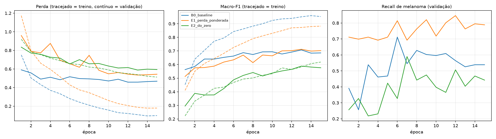
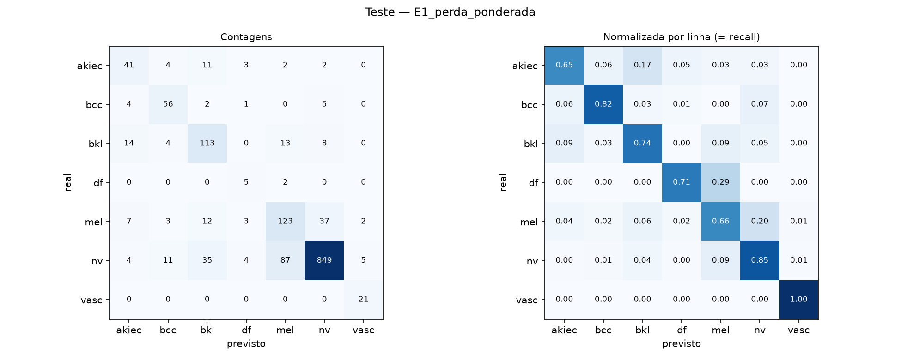
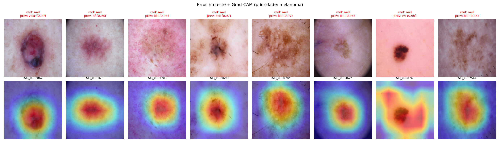

# Classificação de Lesões de Pele com Incerteza e Explicabilidade

Projeto final da disciplina de **Visão Computacional** (Ciência de Dados e Inteligência Artificial, Ibmec BH, 2º semestre de 2026).

Uma CNN classifica imagens dermatoscópicas em 7 categorias diagnósticas do HAM10000. Quando a confiança fica abaixo de um limiar, ela marca a previsão como **incerta** e recomenda encaminhar para um especialista. Para cada previsão, gera um mapa **Grad-CAM** que mostra a região da imagem que pesou na decisão.

> ⚠️ **Uso educacional.** Este sistema não é um dispositivo médico e não substitui avaliação clínica.

<!-- Coloque aqui uma figura da demonstração, ex.: demo/demo_ISIC_xxxxxxx.png -->

---

## Sumário
- [Pergunta](#pergunta)
- [Dados](#dados)
- [Abordagem](#abordagem)
- [Experimentos](#experimentos)
- [Resultados](#resultados)
- [Como executar](#como-executar)
- [Estrutura do repositório](#estrutura-do-repositório)
- [Limitações](#limitações)
- [Referências](#referências)

---

## Pergunta
Uma CNN treinada no HAM10000 consegue classificar as 7 categorias diagnósticas com **macro-F1 competitiva** e **bom recall de melanoma**? Ela também consegue sinalizar quando está incerta e mostrar em que região da imagem baseou a decisão?

| Classe | Descrição |
|---|---|
| `akiec` | Ceratose actínica / doença de Bowen |
| `bcc` | Carcinoma basocelular |
| `bkl` | Ceratose benigna |
| `df` | Dermatofibroma |
| `mel` | **Melanoma**, a classe clinicamente mais crítica |
| `nv` | Nevo melanocítico |
| `vasc` | Lesão vascular |

## Dados
- **Fonte:** [ISIC 2018 Challenge, Task 3 / HAM10000](https://challenge.isic-archive.com/data/#2018). Licença **CC BY-NC 4.0**. As imagens **não são redistribuídas** neste repositório.
- **Volume:** 10.015 imagens RGB de 600×450. Ficaram 10.013 depois de excluir 2 duplicatas exatas (SHA-256).
- **Desbalanceamento:** `nv` concentra cerca de 67% das imagens e `df` cerca de 1% (razão de 58×).

### Split sem vazamento
O HAM10000 tem várias fotos da mesma lesão. Por isso a divisão é feita **por grupo**, nunca por imagem:

- `capture_group` = `lesion_id` unido aos clusters de quase-duplicatas (dHash + confirmação por MAE, agrupados com Union-Find)
- `GroupShuffleSplit` 70/15/15, seed 42

| Split | Imagens | % |
|---|---:|---:|
| Treino | 7.002 | 69,9 |
| Validação | 1.518 | 15,2 |
| Teste | 1.493 | 14,9 |

Cinco testes automáticos de vazamento (grupos, duplicatas, amostras sem split etc.) dão **zero** e são refeitos a cada execução. O teste é usado **uma única vez**, para o modelo final.

### Pré-processamento e aumento de dados
| Operação | Onde |
|---|---|
| RGB → resize 224×224 → normalização (média e desvio calculados **só no treino**) | todos os splits |
| Flips horizontal e vertical, rotação de 90°, brilho e contraste ±15%, recorte de 80–100% (cada um com p=0,5) | só no treino |

## Abordagem
```
imagem → pré-processamento → CNN → softmax → classe + confiança
                                   └→ Grad-CAM → mapa de atenção
confiança < limiar (definido na validação) → "INCERTO: encaminhar para especialista"
```

- **Modelo:** ResNet-18 pré-treinada no ImageNet (torchvision), com a cabeça trocada por Dropout + Linear de 7 saídas.
- **Seleção:** o checkpoint de cada experimento é escolhido pela **macro-F1 de validação**.
- **Incerteza:** os 20% de imagens de validação com menor confiança definem o limiar. No teste, mede-se quanto esse limiar separa acertos de erros (acurácia das confiantes vs. das incertas, AUROC de detecção de erro).
- **Explicabilidade:** Grad-CAM na última camada convolucional, implementado com hooks e sem dependências extras.

## Experimentos
Cada experimento muda **uma única coisa** em relação ao baseline.

| Run | Configuração | Hipótese |
|---|---|---|
| **B0_baseline** | ResNet-18 ImageNet · CrossEntropy · AdamW (lr 1e-4, wd 1e-4) · batch 32 · até 15 épocas, cosine · dropout 0,2 · early stopping (paciência 5) | referência |
| **E1_perda_ponderada** | CrossEntropy ponderada por classe, n/(K·n_c), calculada no treino | sobe a macro-F1 e o recall de `mel`, `df` e `vasc`, com algum custo em `nv` |
| **E2_do_zero** | sem pesos ImageNet | com cerca de 7 mil imagens, a transferência de aprendizado faz muita diferença |
| E3_efficientnet_ponderada *(opcional)* | EfficientNet-B0 + perda ponderada | arquitetura mais eficiente melhora a macro-F1 |

## Resultados
<!-- Preencha com results/comparacao_validacao.csv e results/teste_final.json -->

**Validação**

| Run | Macro-F1 | Acurácia balanceada | Recall `mel` | Acurácia |
|---|---:|---:|---:|---:|
| B0_baseline | – | – | – | – |
| E1_perda_ponderada | – | – | – | – |
| E2_do_zero | – | – | – | – |

**Teste (modelo final: `—`)**

| Métrica | Valor |
|---|---:|
| Acurácia | – |
| Acurácia balanceada | – |
| Macro-F1 | – |
| Recall de melanoma | – |
| Acurácia nas previsões confiantes / incertas | – / – |

<!--



-->

## Como executar

### 1. Ambiente
Python 3.10 ou superior. Para treinar em tempo razoável é recomendada uma GPU NVIDIA.
```bash
# PyTorch com CUDA (ver https://pytorch.org/get-started/locally/)
pip install torch torchvision --index-url https://download.pytorch.org/whl/cu124
pip install -r requirements.txt
```

### 2. Dados
1. Baixe as imagens do **ISIC 2018 Task 3** (`ISIC2018_Task3_Training_Input`) e o arquivo de rótulos.
2. Organize uma pasta com `data/` (imagens) e `outputs_M2/` (`train.csv`, `validation.csv`, `test.csv`):
   ```
   pasta_M2/
   ├── data/images/ISIC2018_Task3_Training_Input/ISIC2018_Task3_Training_Input/*.jpg
   └── outputs_M2/{train,validation,test}.csv
   ```
3. O `config.py` encontra essa pasta sozinho (procura até 3 níveis acima do projeto). Se não encontrar, preencha `M2_DIR_MANUAL` com o caminho dela.

Os manifestos precisam ter, no mínimo, as colunas `sample_id`, `file_path`, `label` e `group_id` (ou `capture_group`).

### 3. Pipeline
```bash
# teste rápido (~1 min): confere se tudo está no lugar
python train.py --exp B0_baseline --limit 140 --set epochs=1

# fluxo completo
python train.py                       # treina B0, E1 e E2
python compare.py                     # compara na validação e escolhe o modelo final
python evaluate.py                    # avaliação única no teste + figuras
python predict.py --from-test 6       # demonstração com imagens nunca vistas
python predict.py minha_imagem.jpg    # demonstração com imagem externa
```
Também é possível rodar tudo pelo notebook `projeto_final.ipynb`.

> **Windows:** se o DataLoader der erro, adicione `--set num_workers=0`.

## Estrutura do repositório
```
├── config.py              # caminhos, hiperparâmetros e definição dos experimentos
├── train.py               # treina os experimentos
├── compare.py             # comparação na validação → results/modelo_final.txt
├── evaluate.py            # teste final, incerteza, análise de erros, Grad-CAM
├── predict.py             # demonstração: imagem → resultado
├── projeto_final.ipynb    # executa o fluxo completo com as figuras
├── src/
│   ├── data.py            # manifestos, checagem de vazamento, Dataset, transformações
│   ├── models.py          # ResNet / EfficientNet (torchvision)
│   ├── engine.py          # loop de treino, métricas, early stopping
│   └── gradcam.py         # Grad-CAM
├── runs/                  # (gerado) checkpoints e histórico por experimento
├── results/               # (gerado) tabelas, métricas e figuras
└── demo/                  # (gerado) figuras da demonstração
```

## Limitações
- **Desbalanceamento:** `df` tem só 7 imagens no teste, então as métricas dessa classe são instáveis.
- **Representatividade:** datasets dermatoscópicos públicos sub-representam tons de pele mais escuros, e o HAM10000 não tem metadado para verificar isso.
- **Atalhos visuais:** a auditoria encontrou sinal preditivo em tamanho de arquivo, nitidez e brilho (acurácia balanceada de 0,29 contra 0,14 do acaso). A taxa de erro por faixa de brilho é monitorada no teste.
- **Segmentação não treinada:** as imagens com máscara (Task 1) e as com rótulo (Task 3) não se sobrepõem. Por isso o Grad-CAM é usado como localização qualitativa.
- **Reprodutibilidade:** seed 42 fixa, mas `cudnn.benchmark` e precisão mista podem causar pequenas variações na GPU.

## Referências
- Tschandl, P., Rosendahl, C., Kittler, H. *The HAM10000 dataset, a large collection of multi-source dermatoscopic images of common pigmented skin lesions.* Scientific Data, 2018.
- Codella, N. et al. *Skin Lesion Analysis Toward Melanoma Detection 2018: A Challenge Hosted by the ISIC.* arXiv:1902.03368, 2019.
- He, K. et al. *Deep Residual Learning for Image Recognition.* CVPR, 2016.
- Selvaraju, R. R. et al. *Grad-CAM: Visual Explanations from Deep Networks via Gradient-based Localization.* ICCV, 2017.

---
**Autora:** Alice De Muylder Oliveira · Ibmec BH
